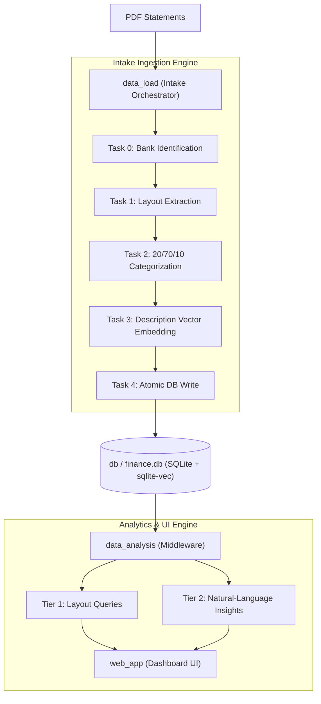

# Personal Finance Automation System

An automated personal finance system designed for Argentine bank statement ingestion (PDFs), deterministic 20/70/10 categorization, semantic description vector search, two-tier analysis middleware, and an interactive Plotly.js dashboard UI. All dashboard charts are scoped exclusively to **TDC credit card** data and served live from SQL queries.

---

## 🚀 Key Features & Capabilities

- **Strict 5-Step Intake Orchestrator (`data_load`)**:
  - **Task 0 (Bank Identification)**: Deterministic pattern matching on page 1 PDF header text & metadata (BBVA, Banco Galicia, Banco Nación, Banco Santander). Zero LLM guessing; fails loud on unidentified files.
  - **Task 1 (Layout Extraction)**: Gemini 3.5 Flash document understanding guided by per-bank spec files (`specs/<bank>.md`), preserving exact merchant descriptions, installment tags (`C.03/12`), statement close date, and upcoming installment schedules ("Cuotas a vencer").
  - **Task 2 (Categorization)**: Centralized keyword rules mapping transactions into 20/70/10 budget macro groups. Forces Food Delivery into Leisure and tags payment movements with `excluded_from_budget: true`.
  - **Task 3 (Embedding)**: Vectorizes normalized `description` text ONLY (`all-MiniLM-L6-v2`), keeping numeric amounts, dates, and category labels as structured DB metadata.
  - **Task 4 (Database Write)**: Single atomic SQLite commit for relational transactions, upcoming installments, `sqlite-vec` embeddings, and processed file markers.
- **Two-Tier Data Analysis Middleware (`data_analysis`)**:
  - **Tier 1 (Layout Queries)**: 100% deterministic SQL aggregations scoped to `account_type = 'tdc'` serving dashboard charts (Monthly Expenses, 20/70/10 Macro Groups, 2-Level Category Sunburst, Stacked Billed vs. Upcoming Installments).
  - **Tier 2 (Insight Queries)**: Multi-route decision engine (`sql_only`, `sql_recurrence`, `hybrid`) answering open-ended financial questions.
- **Interactive Dashboard UI (`web_app`)**:
  - **Live Data Pipeline**: Charts fetch real-time SQL aggregations from `GET /api/charts` on every page load and cross-filter interaction — no static/hardcoded data.
  - **Direct UI Statement Intake**: Uploading a PDF via drag-and-drop automatically triggers the 5-step Intake Orchestrator with real-time visual feedback.
  - **Global Status Indicator**: Header status pill communicates app state (Ready / Loading / Processing / Success / Error) with animated transitions.
  - **Collapsible Stacked Side Panel**: PDF upload zone with indeterminate progress bar + scrollable AI assistant chat thread with typing indicator and state persistence.
  - **Cross-Filtering**: Interactive Plotly.js charts with stacked filter pills and a "Reset filters" button.
  - **Financial Trust Palette**: Deep Navy (`#1B3A5C`), Muted Teal (`#3E7C74`), Soft Gray Background (`#F7F8FA`), and fixed 9-category color assignments across macro families.

---

## 📥 Inputs & 📤 Outputs

### Inputs
- **Bank Statement PDFs**: Spanish language statements from BBVA, Banco Galicia, Banco Nación (BNA), or Banco Santander (consolidated checking/savings & credit card statements).
- **Upload Sources**: Ingested via Web UI Drag-and-Drop (`web_app`), local folder (`local_input/`), or Google Drive API.

### Outputs
- **Relational Store**: `transactions` (with `category`, `macro_group`, `excluded_from_budget`, `close_date`), `upcoming_installments`, `processed_files`, and `errors`.
- **Vector Store**: 384-dimensional `transaction_vectors` for hybrid vector+filter semantic search.
- **Visual Dashboard**: Interactive Plotly.js column charts, pie chart, category sunburst, and stacked installment charts.

---

## 📐 Architecture & Module Map



| Package / Module | Responsibility |
|---|---|
| [`data_load/`](file:///c:/Users/mezap/Documents/finance-agent/data_load/) | **Intake Orchestrator**: Executes Tasks 0 → 1 → 2 → 3 → 4 sequentially per PDF statement. |
| [`data_analysis/`](file:///c:/Users/mezap/Documents/finance-agent/data_analysis/) | **Data Analysis Middleware**: Serves Tier 1 chart aggregations and Tier 2 insight queries, scoped exclusively to TDC credit card data. |
| [`db/`](file:///c:/Users/mezap/Documents/finance-agent/db/) | **Storage Layer**: SQLite schema setup, atomic write operations, and `sqlite-vec` vector store management. |
| [`web_app/`](file:///c:/Users/mezap/Documents/finance-agent/web_app/) | **Web Application & UI**: Flask server (`app.py`), live chart endpoint (`/api/charts`), auto-intake processor, AI Assistant (`chat.py`), and Plotly.js Dashboard UI with global status indicator. |
| [`tests/`](file:///c:/Users/mezap/Documents/finance-agent/tests/) | **Automated Test Suite**: Unit and integration test coverage for intake orchestration, categorization, embeddings, DB atomic commits, and analytics functions. |

---

## 🛠️ Installation & Setup

### 1. Prerequisites
- Python 3.10+
- Gemini API Key (`GEMINI_API_KEY`)

### 2. Environment Setup
Clone the repository and install dependencies:
```bash
git clone <repository-url>
cd finance-agent
pip install -r requirements.txt
```

Create a `.env` file in the project root:
```env
GEMINI_API_KEY=your_gemini_api_key_here
DATA_SOURCE=local
```

---

## 💻 Running the Application

### Option A: Complete Application & Web Dashboard (Recommended)
Run the startup script to initialize the database, execute pending statement intake, and launch the live web dashboard:

**On Linux / macOS / WSL**:
```bash
./run_web_app.sh
```

**On Windows PowerShell**:
```powershell
.\run_web_app.ps1
```

Or start the web server directly:
```bash
python web_app/app.py
```
Open your browser at **`http://localhost:5000`**.

### Option B: Batch CLI Statement Intake
Place statement PDFs in `local_input/` and execute:
```bash
python main.py load
```

---

## 🧪 Running Unit & Integration Tests

Run the complete test suite:
```bash
python -m unittest discover -s tests
```
