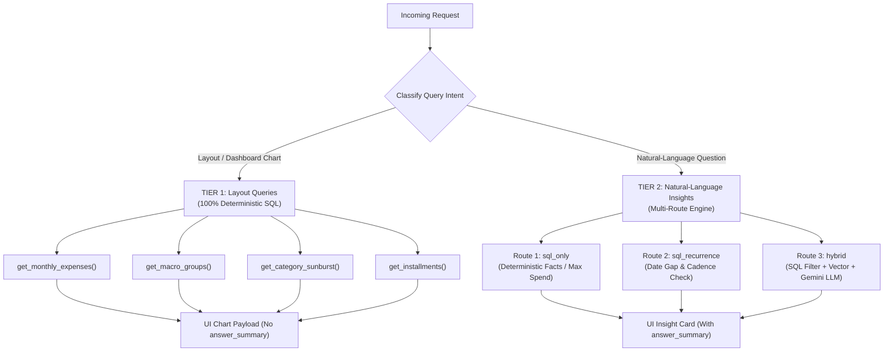

# Data Analysis Middleware Specification

The `data_analysis` module serves as the **Data Analysis Middleware** for the personal finance automation system. It sits directly between the persisted database (`finance.db` relational + vector store) and the UI dashboard/chat endpoints.

It operates in a read-only capacity — querying, aggregating, and formatting financial records into UI-ready JSON payloads. Categorization and 20/70/10 budget grouping are performed during intake (Task 2) and are never recomputed here.

---

## 📐 Architecture & Decision Routing

Queries are handled across two distinct tiers based on whether they require deterministic UI chart data or open-ended natural-language insights.



---

## 📁 Function Registry

| Function | Tier | Responsibility |
|---|---|---|
| [`get_monthly_expenses(conn, month?, macro_group?)`](file:///c:/Users/mezap/Documents/finance-agent/data_analysis/analysis.py#L39-L66) | Tier 1 | Aggregates monthly spend over time. |
| [`get_macro_groups(conn, month?)`](file:///c:/Users/mezap/Documents/finance-agent/data_analysis/analysis.py#L69-L93) | Tier 1 | Aggregates spend across 20/70/10 macro groups. |
| [`get_category_sunburst(conn, month?, macro_group?)`](file:///c:/Users/mezap/Documents/finance-agent/data_analysis/analysis.py#L96-L171) | Tier 1 | Builds 2-level (`category` → `description`) hierarchical sunburst arrays with unique IDs. |
| [`get_installments(conn, month?)`](file:///c:/Users/mezap/Documents/finance-agent/data_analysis/analysis.py#L174-L234) | Tier 1 | Combines historical billed and upcoming projected installments into a single series with `type` flags. |
| [`query_insights(conn, query)`](file:///c:/Users/mezap/Documents/finance-agent/data_analysis/analysis.py#L241-L262) | Tier 2 | Classifies questions and routes them to `sql_only`, `sql_recurrence`, or `hybrid` LLM judgment. |
| [`analyze_prompt(conn, prompt, start_date?, end_date?)`](file:///c:/Users/mezap/Documents/finance-agent/data_analysis/analysis.py#L419-L434) | Router | Backwards-compatible prompt router delegating to Tier 1 or Tier 2. |

---

## ⚙️ Global Execution Rules

1. **Payment Exclusion**: Every query strictly excludes transactions tagged `excluded_from_budget = 1` or `category = 'Payment'`.
2. **Positive Amounts**: Applies `ABS(amount)` to all financial numbers before aggregation so chart magnitudes remain positive.
3. **2-Decimal Rounding**: All summed values are rounded to 2 decimal places (`ROUND(..., 2)`) to eliminate floating-point drift.
4. **Contract Output Distinction**:
   - **Tier 1 responses NEVER contain an `answer_summary` field.** (UI renders as chart component).
   - **Tier 2 responses ALWAYS contain an `answer_summary` field.** (UI renders as insight card).
5. **Graceful Degradation**: Zero-row query results return empty `data` / `supporting_data` arrays with the exact schema contract (never `null` or error objects).

---

## 📊 Tier 1: Layout Queries (Deterministic SQL)

### 1. `get_monthly_expenses()`
- **Purpose**: Power the monthly spend line/bar chart.
- **Filters**: Optional `month` (`YYYY-MM`) and `macro_group`.
- **Output Schema**:
  ```json
  {
    "chart": "monthly_expenses",
    "data": [
      { "month": "2026-06", "total": 812340.55 },
      { "month": "2026-07", "total": 745210.10 }
    ]
  }
  ```

### 2. `get_macro_groups()`
- **Purpose**: Power the 20/70/10 budget macro group breakdown pie/bar chart.
- **TDC Credit Card Scope**: All Tier 1 layout queries and Tier 2 natural language routes exclusively query and aggregate transactions where `account_type = 'tdc'` (credit card statement data). Bank account checking/savings data (`account_type = 'account'`) is strictly dismissed from budget charts and insight calculations.
- **Budget Categorization**:
  - `70% Needs/Fixed Pays`: Supermarket, Utilities, Insurance
  - `20% Savings & Invest`: Savings, Investment
  - `10% Leisure & Others`: Leisure, Streaming, Food Delivery, Other/Uncategorized
- **Output Schema**:
  ```json
  {
    "chart": "macro_groups",
    "filter_applied": { "month": "2026-07" },
    "data": [
      { "macro_group": "70% Needs/Fixed Pays", "total": 520000.00 },
      { "macro_group": "20% Savings & Invest", "total": 150000.00 },
      { "macro_group": "10% Leisure & Others", "total": 75210.10 }
    ]
  }
  ```

### 3. `get_category_sunburst()`
- **Purpose**: Power the Plotly multi-level sunburst chart.
- **Hierarchy**: Strict two levels (`category` → `description`). Macro group is a separate filter, not a sunburst level.
- **Node Rules**:
  - Root category node IDs: `"CategoryName"`
  - Leaf description node IDs: `"CategoryName-DescriptionClean"` (uniquely prefixed to prevent collisions across categories).
- **Output Schema**:
  ```json
  {
    "chart": "category_sunburst",
    "filter_applied": { "month": "2026-07", "macro_group": null },
    "data": {
      "ids": ["Streaming", "Streaming-Netflix", "Streaming-Spotify"],
      "labels": ["Streaming", "Netflix", "Spotify"],
      "parents": ["", "Streaming", "Streaming"],
      "values": [8500.00, 5500.00, 3000.00]
    }
  }
  ```

### 4. `get_installments()`
- **Purpose**: Power the historical vs. projected upcoming installments chart.
- **Source**: Billed items from `transactions` (`installment IS NOT NULL`) + projected items from `upcoming_installments`.
- **Output Schema**:
  ```json
  {
    "chart": "installments_over_time",
    "data": [
      { "month": "2026-06", "amount": 45000.00, "type": "billed" },
      { "month": "2026-08", "amount": 171026.07, "type": "upcoming" }
    ]
  }
  ```

---

## 🧠 Tier 2: Natural-Language Insight Queries

Natural-language questions are classified and routed across three execution paths:

| Question Signal | Route Name | Execution Method | Example Query |
|---|---|---|---|
| Single deterministic fact | `sql_only` | Pure SQL `ORDER BY ABS(amount) DESC LIMIT 1` | "What's the largest spend with no category?" |
| Pattern absence / cadence change | `sql_recurrence` | SQL frequency calculation + Date gap check (>= 45 days) | "What stopped being charged?" |
| Subjective ranking / recommendation | `hybrid` | SQL filter (`10% Leisure`) + Vector grouping + Gemini 3.5 Flash | "Which leisure spends are easier to remove?" |

### Tier 2 Uniform Output Contract
```json
{
  "query": "which leisure spends are easier to remove",
  "route": "hybrid",
  "answer_summary": "Discretionary food delivery and dining out expenses are easiest to remove immediately.",
  "supporting_data": [
    {
      "description": "Starbucks",
      "category": "Food Delivery",
      "frequency": 6,
      "total_amount": 42000.00,
      "removal_ease": "easy"
    }
  ]
}
```

---

## 💻 Usage & Verification

### Executing Queries in Python
```python
from db.db import fresh_connection
from data_analysis import get_monthly_expenses, query_insights

with fresh_connection() as conn:
    # Tier 1 Layout Query
    monthly_chart = get_monthly_expenses(conn, month="2026-07")
    
    # Tier 2 Natural-Language Insight Query
    insight_card = query_insights(conn, "What stopped being charged?")
```

### Running Test Suite
```bash
python -m unittest discover -s tests
```
