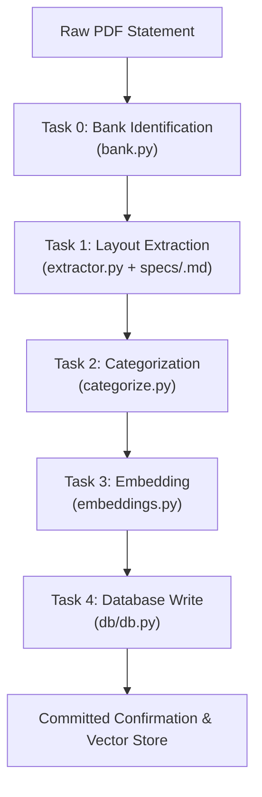

# Data Load & Intake Orchestrator Specification

The `data_load` module functions as the **Intake Orchestrator** for the personal finance automation system. It ingests Argentine bank statement PDFs (BBVA, Banco Galicia, Banco Nación, Banco Santander) and processes them through five strictly sequential steps.

---

## 📐 Pipeline Architecture & Sequential Flow

Processing is strictly sequential: **`Task 0 → Task 1 → Task 2 → Task 3 → Task 4`**. Each step's output serves as the next step's only input. Steps are never skipped, merged, or run in parallel.



---

## 📁 File & Module Structure

| File | Primary Responsibility |
|---|---|
| [`orchestrator.py`](file:///c:/Users/mezap/Documents/finance-agent/data_load/orchestrator.py) | **Intake Orchestrator**: Executes Tasks 0 through 4 sequentially per PDF statement. |
| [`bank.py`](file:///c:/Users/mezap/Documents/finance-agent/data_load/bank.py) | **Task 0**: Deterministic bank identification using first-page PDF header text matching. |
| [`extractor.py`](file:///c:/Users/mezap/Documents/finance-agent/data_load/extractor.py) | **Task 1**: Document layout extraction using Gemini 3.5 Flash & `specs/<bank>.md`. |
| [`categorize.py`](file:///c:/Users/mezap/Documents/finance-agent/data_load/categorize.py) | **Task 2**: Centralized keyword-to-category table mapping and 20/70/10 budget grouping. |
| [`embeddings.py`](file:///c:/Users/mezap/Documents/finance-agent/data_load/embeddings.py) | **Task 3**: Description-only text normalization and 384-dim vector generation. |
| [`specs/`](file:///c:/Users/mezap/Documents/finance-agent/data_load/specs/) | Markdown layout rules per bank ([`bbva.md`](file:///c:/Users/mezap/Documents/finance-agent/data_load/specs/bbva.md), [`bna.md`](file:///c:/Users/mezap/Documents/finance-agent/data_load/specs/bna.md), [`galicia.md`](file:///c:/Users/mezap/Documents/finance-agent/data_load/specs/galicia.md), [`santander.md`](file:///c:/Users/mezap/Documents/finance-agent/data_load/specs/santander.md)). |
| [`drive_client.py`](file:///c:/Users/mezap/Documents/finance-agent/data_load/drive_client.py) | Google Drive API integration for listing, downloading, and moving processed PDFs. |
| [`local_client.py`](file:///c:/Users/mezap/Documents/finance-agent/data_load/local_client.py) | Filesystem drop-in client for local testing (`local_input/` → `local_processed/`). |

---

## ⚙️ Detailed Task Breakdown

### TASK 0: Bank Identification (`bank.py`)
- **Goal**: Identify the issuing bank of an uploaded PDF.
- **Method**: Deterministic pattern matching on the PDF's first page text (`pypdf.PdfReader`) and CUIT / IBAN metadata.
- **Rules**: Zero LLM inference or guessing. If no bank signature matches confidently, or if multiple banks match, the process **halts immediately** (`ValueError`).
- **Output**:
  ```json
  { "file": "statement_01.pdf", "bank": "bbva" }
  ```

### TASK 1: Layout Extraction (`extractor.py`)
- **Goal**: Convert the raw PDF into normalized transaction records and statement metadata.
- **Method**: Dynamically loads `specs/<bank>.md` matching the Task 0 bank result and invokes Gemini 3.5 Flash with document understanding.
- **Extracted Fields**:
  - `bank`: string (`"bbva"`, `"galicia"`, `"bna"`, `"santander"`)
  - `account_type`: string (`"account"` or `"tdc"`)
  - `card_network`: string (`"visa"`, `"master"`, or `null`)
  - `close_date`: ISO YYYY-MM-DD statement closing date
  - `date`: ISO YYYY-MM-DD transaction date
  - `description`: exact raw printed text (preserves installment tags like `C.03/12` unmodified)
  - `amount`: signed decimal (debits/charges negative, credits/payments positive)
  - `currency`: `"ARS"` or `"USD"`
  - `installment`: string (`"03/12"`) or `null`
  - `upcoming_installments`: array of upcoming installment commitments (`[{"month": "2026-08", "amount": 171026.07}]`)
- **Output**:
  ```json
  {
    "close_date": "2026-07-30",
    "transactions": [
      {
        "bank": "bbva",
        "account_type": "tdc",
        "card_network": "visa",
        "close_date": "2026-07-30",
        "date": "2026-07-15",
        "description": "CARREFOUR EXPRESS C.03/12",
        "amount": -15200.50,
        "currency": "ARS",
        "installment": "03/12"
      }
    ],
    "upcoming_installments": [
      { "month": "2026-08", "amount": 15200.50 }
    ]
  }
  ```

### TASK 2: Categorization (`categorize.py`)
- **Goal**: Assign category, budget macro group, and payment exclusion flag to every transaction.
- **Method**: Centralized deterministic keyword table lookup.
- **20/70/10 Macro Groups**:
  - **70% Needs/Fixed Pays**: `Supermarket`, `Utilities`, `Insurance`
  - **20% Savings & Invest**: `Savings`, `Investment`
  - **10% Leisure & Others**: `Leisure`, `Streaming`, `Food Delivery`, `Other/Uncategorized`
- **Rules**:
  - Food delivery (Rappi, PedidosYa, UberEats) is **always** `Food Delivery` (`10% Leisure & Others`).
  - Card/bill payment movements ("su pago", "pago tarjeta") are tagged `excluded_from_budget: true`.

### TASK 3: Embedding (`embeddings.py`)
- **Goal**: Generate 384-dimensional vector embeddings for semantic search over transactions.
- **Method**: Vectorizes normalized `description` text ONLY (`all-MiniLM-L6-v2`).
- **Rule**: Keeps numeric amounts, dates, and category labels **out** of the vector string; stores them strictly as structured database metadata to avoid similarity bias.

### TASK 4: Database Write (`db/db.py`)
- **Goal**: Persist everything deterministically and idempotently.
- **Method**: Atomic SQLite transaction writing relational transaction rows, upcoming installments, sqlite-vec embeddings, and processed file markers in a single `BEGIN TRANSACTION` block.
- **Output**:
  ```json
  { "file": "statement_01.pdf", "bank": "bbva", "transactions_written": 42, "status": "committed" }
  ```

---

## 🚨 Error Handling & Failure Policy

1. **Fail Loud**: Unidentified banks, missing API keys, invalid JSON schemas, or database write failures immediately raise exceptions and stop that file's execution.
2. **Transaction Rollback**: If Task 4 fails midway, the entire SQLite database transaction rolls back, ensuring zero partial or orphaned records.
3. **Traceability**: All errors are logged to the `errors` table in `finance.db`.

---

## 💻 Usage & Verification

### Ingesting Files Programmatically
```python
from data_load import run_intake

result = run_intake("local_input/bbva_statement.pdf")
print(result)
# Output: {'file': 'bbva_statement.pdf', 'bank': 'bbva', 'transactions_written': 15, 'status': 'committed'}
```

### Running Test Suite
```bash
python -m unittest discover -s tests
```
