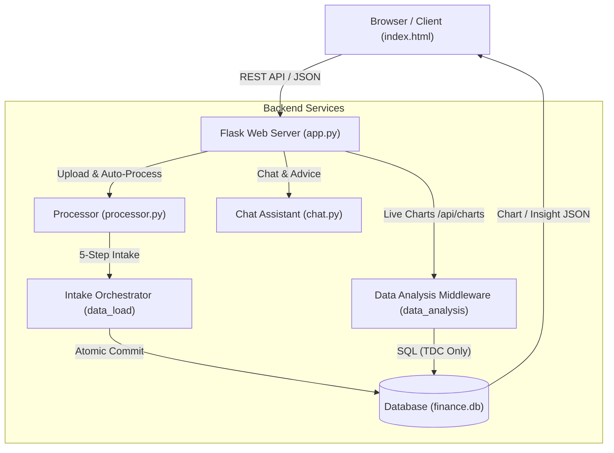

# Web Application & Dashboard UI Specification

The `web_app` module provides the interactive web interface for the personal finance automation system. It features a self-contained Plotly.js dashboard, an intake statement PDF uploader with automatic processing, and an AI chat assistant connected to the 5-step Intake Orchestrator and Data Analysis Middleware. All chart data is served live from the database via `/api/charts`, scoped exclusively to **TDC credit card** (`account_type = 'tdc'`) transactions.

---

## 📐 System Architecture



---

## 📁 File Structure

| File / Folder | Primary Responsibility |
|---|---|
| [`app.py`](file:///c:/Users/mezap/Documents/finance-agent/web_app/app.py) | **Flask REST Server**: Exposes `/api/charts`, `/api/upload`, `/api/process_upload/<id>`, `/api/chat`, `/api/analysis_query`, and static file routing. |
| [`processor.py`](file:///c:/Users/mezap/Documents/finance-agent/web_app/processor.py) | **Backend Processor**: `get_all_chart_data()` unified chart endpoint, PDF file saving, Intake Orchestrator execution, and database analytics retrieval. |
| [`chat.py`](file:///c:/Users/mezap/Documents/finance-agent/web_app/chat.py) | **AI Assistant Handler**: Gemini 3.5 Flash chat integration and user intent detection. |
| [`frontend_static/index.html`](file:///c:/Users/mezap/Documents/finance-agent/web_app/frontend_static/index.html) | **Dashboard UI**: Self-contained HTML/CSS/JS SPA with Plotly.js charts, collapsible side panel, global status indicator, typing indicator, and real-time state feedback. |

---

## 🎨 Dashboard UI & Layout Specifications

The dashboard UI is housed entirely within [`frontend_static/index.html`](file:///c:/Users/mezap/Documents/finance-agent/web_app/frontend_static/index.html).

### 1. Data Scope: TDC Credit Card Only

All dashboard charts and analysis queries exclusively display transactions where `account_type = 'tdc'` (credit card statement data). Bank account checking/savings data is dismissed from all budget visualizations and insight calculations.

### 2. Collapsible Stacked Side Panel
- **Collapsed State**: A slim ~32px vertical tab fixed to the right edge labeled "Assistant" with a background activity notification dot.
- **Expanded State**: Panel slides out from the right (~25% viewport width, min 320px, max 400px). Smoothly shrinks the chart grid area without overlaying charts.
- **Mobile Responsiveness (<900px)**: Converts to a full-height overlay when expanded to preserve chart readability.
- **Stacked Interior**:
  1. **Top: Upload Drop Zone**: Fixed height (~100px), accepts PDF bank statements via drag-and-drop or click-to-browse. Displays filename and indeterminate progress bar during processing.
  2. **Bottom: Chat Thread**: Scrollable message history with pinned user input at the bottom.
- **State Persistence**: Collapsing and reopening the panel preserves chat message history, scroll position, and upload state without re-rendering or resetting charts.

---

### 3. Live Chart Data Pipeline

On page load, the UI calls `GET /api/charts` to fetch all four chart datasets from live SQL queries against `finance.db`. Charts are **never rendered from hardcoded/static data** — the embedded JSON fallback contains empty arrays and is only used if the backend is unreachable.

**Cross-filter flow**: Clicking a chart element (month bar or pie slice) triggers `fetchAndRenderLiveCharts(month, macroGroup)` which calls `/api/charts?month=...&macro_group=...` and re-renders all four charts with filtered SQL results.

---

### 4. Four Plotly.js Charts & Cross-Filtering

| Position | Chart Component | Data Contract | Description |
|---|---|---|---|
| Top (Full Width) | Monthly Expenses | `monthly_expenses` | Column chart displaying total TDC spend per statement period (`month`). |
| Middle Left | 20/70/10 Macro Groups | `macro_groups` | Donut/Pie chart illustrating 70% Needs, 20% Savings, 10% Leisure. |
| Middle Right | Category Sunburst | `category_sunburst` | 2-level hierarchy (`category` → `description`) with unique Plotly node IDs. |
| Bottom (Full Width) | Installments Over Time | `installments_over_time` | Stacked column chart of historical billed (`"billed"`) vs. projected upcoming (`"upcoming"`) installments. |

**Cross-Filtering Mechanics**:
- Clicking a month column filters the Pie and Sunburst charts to that specific month.
- Clicking a Pie slice filters the Sunburst chart to that macro group.
- Active filters display as pill tags in the header alongside a **"Reset Filters"** control button.

---

### 5. Global Status Indicator & Visual Feedback System

A persistent status pill in the header bar communicates the current application state at all times:

| State | Pill Appearance | Upload Zone | Chat Thread | Chat Input |
|---|---|---|---|---|
| **Idle / Ready** | 🟢 Green tint — "Ready" | Normal | — | Enabled |
| **Loading Charts** | 🔵 Blue tint — "Loading charts..." | — | — | Enabled |
| **Uploading PDF** | 🔵 Blue tint — "Uploading file.pdf..." | Amber border + progress bar | — | Enabled |
| **Processing Intake** | 🟡 Amber pulsing — "Processing file.pdf..." | Indeterminate progress bar | Bouncing dots typing indicator + step description | Disabled ("Waiting for response...") |
| **Waiting for AI** | 🔵 Blue tint — "Waiting for AI response..." | — | Typing indicator | Disabled |
| **Success** | 🟢 Green solid — "63 transactions loaded" | Progress stops | Confirmation message | Re-enabled |
| **Error** | 🔴 Red solid — "Intake failed" | Stops processing | Error message | Re-enabled |

Success and error states auto-revert to "Ready" after 4 seconds.

---

### 6. Direct UI Statement Intake Processing

When a user uploads a PDF via drag-and-drop or file browse:
1. **Upload**: `POST /api/upload` saves the file and returns a `fileId`.
2. **Auto-Process**: The UI automatically calls `POST /api/process_upload/<fileId>` to trigger the 5-step Intake Orchestrator (Task 0 → 1 → 2 → 3 → 4).
3. **Live Feedback**: During processing, the global status pill pulses amber, the upload zone shows an indeterminate progress bar, and the chat thread displays a typing indicator.
4. **Chart Refresh**: On success, the backend returns fresh `charts` data and the UI calls `fetchAndRenderLiveCharts()` to update all four Plotly charts with the newly ingested transactions.

---

## 🎨 Financial Trust Palette & Fixed Category Colors

The UI enforces a calm, professional financial palette without high-chroma or alarming decorative red.

### Base UI Palette
- **Primary / Trust Anchor**: `#1B3A5C` (Deep Navy)
- **Primary Hover**: `#26527E`
- **Secondary / Calm Accent**: `#3E7C74` (Muted Teal)
- **Background**: `#F7F8FA` (Soft Off-White)
- **Surface**: `#FFFFFF` (White Cards)
- **Border**: `#E2E5E9` (Light Gray)
- **Text Primary**: `#1A2530` (Near-Black Navy)
- **Text Secondary**: `#5B6672` (Slate Gray)
- **Warning**: `#C58B2E` (Muted Amber)
- **Danger (Reserved)**: `#B54B3F` (Muted Brick Red)

### Fixed 9-Category Color Assignments

| Macro Group Family | Category | Assigned Hex | Visual Tone |
|---|---|---|---|
| **70% Needs/Fixed Pays** (Blue Family) | Supermarket | `#1B3A5C` | Deep Navy |
| | Utilities | `#3D6A94` | Medium Blue |
| | Insurance | `#7FA6C9` | Soft Sky Blue |
| **20% Savings & Invest** (Green Family) | Savings | `#2F6B4F` | Forest Green |
| | Investment | `#6FA985` | Sage Green |
| **10% Leisure & Others** (Warm Neutral Family) | Leisure | `#C58B2E` | Muted Amber |
| | Streaming | `#D9A857` | Warm Gold |
| | Food Delivery | `#B8895F` | Tan / Bronze |
| | Other / Uncategorized | `#8C8378` | Warm Slate Gray |

---

## 🔌 REST API Endpoints (`app.py`)

| Method | Endpoint | Description | Request | Response |
|---|---|---|---|---|
| `GET` | `/api/charts` | **Unified live chart data** (all 4 Tier 1 queries) | `?month=YYYY-MM&macro_group=...` | `{monthly_expenses, macro_groups, category_sunburst, installments, filter_applied}` |
| `POST` | `/api/upload` | Upload PDF statement | `multipart/form-data` file | `{fileId, fileName, status, message}` |
| `POST` | `/api/process_upload/<file_id>` | **Run 5-step Intake Orchestrator** on uploaded PDF | None | `{success, message, transactions_written, charts}` |
| `POST` | `/api/chat` | Chat message & intake trigger | `{message, fileId}` | `{reply, charts}` |
| `GET` | `/api/summary` | Summary charts data | None | `{macro_groups, monthly_expenses}` |
| `GET` | `/api/transactions` | Recent TDC transactions | `?limit=20` | `[{id, description, amount, ...}]` |
| `GET` | `/api/analysis` | Sunburst hierarchy data | `?month=...&macro_group=...` | `{chart, data}` |
| `POST` | `/api/analysis_query` | Tier 2 natural language query | `{prompt}` | `{query, route, answer_summary, supporting_data}` |
| `GET` | `/` | Serve UI | None | HTML Page (`index.html`) |

---

## 💻 Running & Verification

### Full Application Startup
```bash
./run_web_app.sh       # Linux / macOS / WSL
.\run_web_app.ps1      # Windows PowerShell
```
This initializes the database, runs pending statement intake, and launches the Flask server at `http://localhost:5000`.

### Web Server Only
```bash
python web_app/app.py
```
